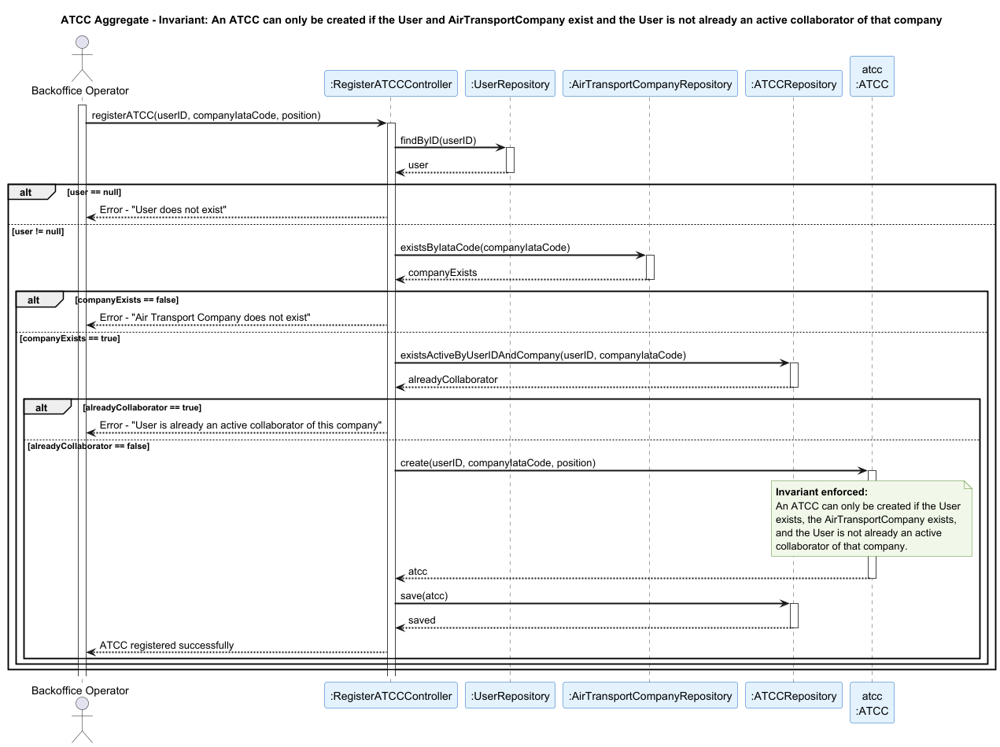

## ATCC Aggregate

### Aggregate Root: `ATCC`

### Scenario: Registering an ATCC Collaborator for a Company That Already Has That User

A Backoffice Operator attempts to register a new ATCC collaborator (US061). The operation must be rejected if the user is already a collaborator of that company, or if the associated user or company does not exist.

### Invariant Enforced

> **An `ATCC` may only be created if the associated `User` exists, the associated `AirTransportCompany` exists, and that `User` is not already an active collaborator of that company.**

The `ATCC` aggregate root is the sole entry point for the creation of a collaborator. It is therefore the only object capable of consistently enforcing that the same user cannot be registered twice as a collaborator of the same company. Allowing duplicate collaborators would compromise the integrity of the system, since `ATCC` collaborators have direct access to sensitive operations such as registering aircraft, managing flight routes and managing pilots.

### Sequence Diagram

