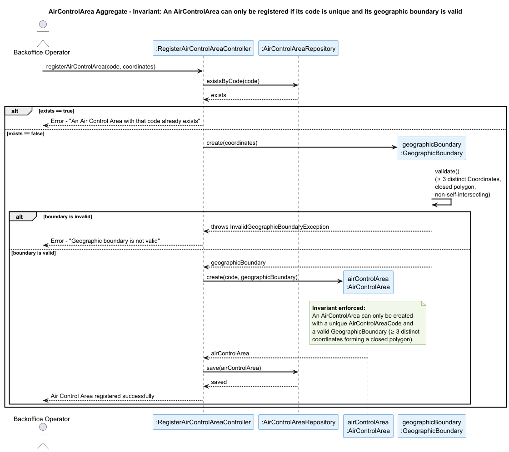

## AirControlArea Aggregate

### Aggregate Root: `AirControlArea`

### Scenario: Registering an Air Control Area with an Invalid Boundary or Duplicate Code

A Backoffice Operator attempts to register a new Air Control Area in the system (US050). The operation must be rejected if the provided area code already exists in the system, or if the geographic boundary is not valid — meaning the list of coordinates does not form a closed polygon with at least three distinct points.

### Invariant Enforced

> **An `AirControlArea` may only be created with a unique `AirControlAreaCode` and a valid `GeographicBoundary` composed of at least three distinct `Coordinates` forming a closed, non-self-intersecting polygon.**

The `AirControlArea` aggregate root is the sole entry point for the creation of an air control area. It is therefore the only object capable of consistently enforcing both the uniqueness of the code and the geometric validity of the boundary before any state is persisted. Allowing the registration of an area with an invalid or duplicated boundary would corrupt the spatial structure of the system, since downstream aggregates such as `Airport` and `WeatherData` depend on `AirControlAreaCode` to correctly associate themselves with a geographic region.

---

### Sequence Diagram

