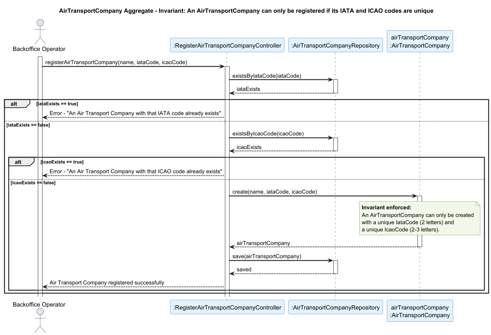

## AirTransportCompany Aggregate

### Aggregate Root: `AirTransportCompany`

### Scenario: Registering an Air Transport Company with Duplicate Codes

A Backoffice Operator attempts to register a new Air Transport Company in the system (US060). The operation must be rejected if the IATA or ICAO code already exists in the system.

### Invariant Enforced

> **An `AirTransportCompany` may only be created with a unique IataCode (2 letters) and a unique IcaoCode (2-3 letters) in the system.**

The `AirTransportCompany` aggregate root is the sole entry point for the creation of an air transport company. It is therefore the only object capable of consistently enforcing the uniqueness of both codes before any state is persisted. Allowing the registration of a company with duplicate codes would corrupt the system, since downstream aggregates such as `Aircraft`, `FlightRoute`, `Pilot` and `ATCC` all depend on the `IataCode` to correctly associate themselves with a company.

### Sequence Diagram

