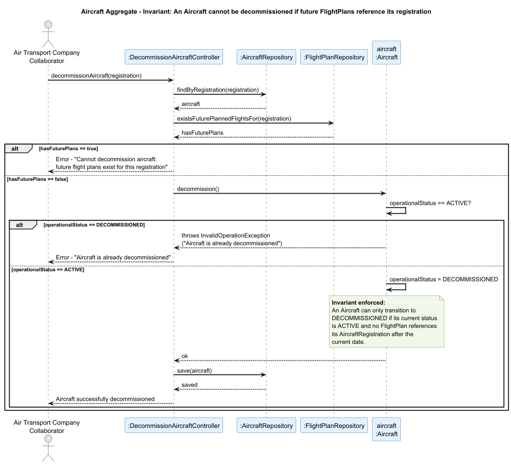

## Aircraft Aggregate

### Aggregate Root: `Aircraft`

### Scenario: Decommissioning an Aircraft with Future Planned Flights

An Air Transport Company Collaborator attempts to decommission an aircraft from the company's fleet (US071). The operation must be rejected if the aircraft already holds an `OperationalStatus` of `DECOMMISSIONED`, or if there are existing `FlightPlan`s referencing its registration that are scheduled for a future date.

### Invariant Enforced

> **An `Aircraft` may only transition to `DECOMMISSIONED` if its current `OperationalStatus` is `ACTIVE` and no `FlightPlan` references its `AircraftRegistration` with a future planned departure.**

The `Aircraft` aggregate root is the sole entry point for changing `OperationalStatus`. It is therefore the only object capable of consistently enforcing this transition rule before any state is persisted. Allowing the decommissioning of an aircraft that still has future flight plans assigned would leave those `FlightPlan` entities in an inconsistent state — referencing an aircraft that is no longer operationally available — making the subsequent flight simulation or validation impossible.
 
---

### Sequence Diagram

