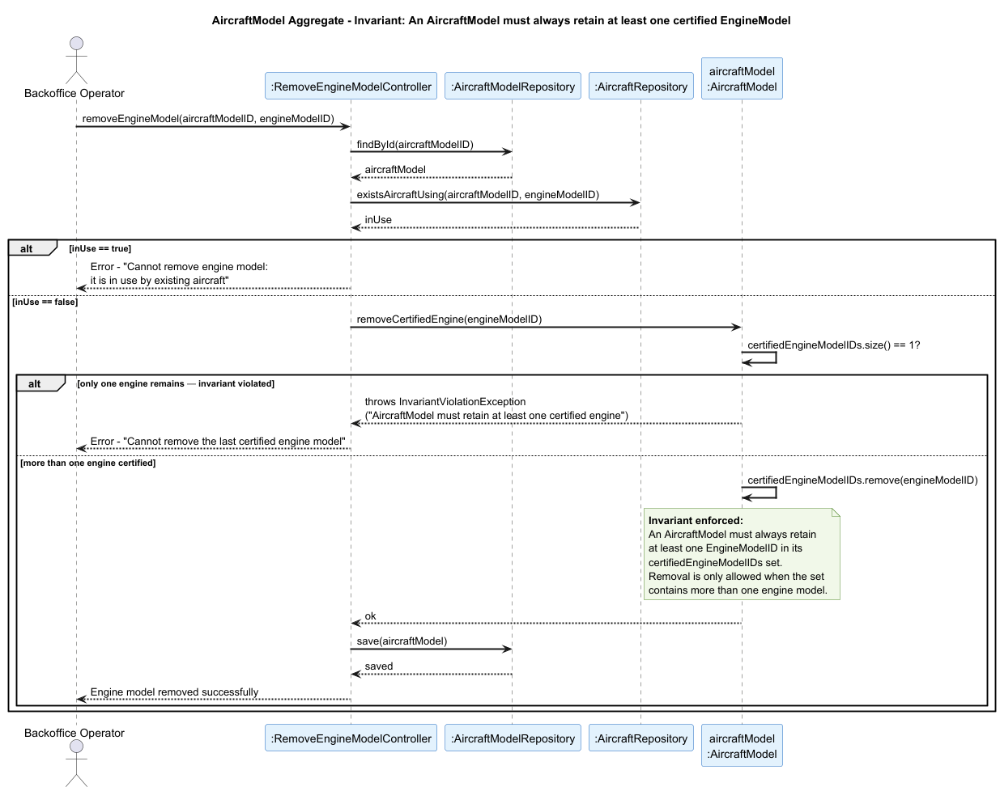

## AircraftModel Aggregate

### Aggregate Root: `AircraftModel`

### Scenario: Removing the Last Certified Engine Model from an Aircraft Model

A Backoffice Operator attempts to remove an engine model from an aircraft model's list of certified engines (US058). The operation must be rejected if the engine model being removed is the last one remaining in the `certifiedEngineModelIDs` set, or if there are existing `Aircraft` instances currently using that engine model in combination with this aircraft model.

### Invariant Enforced

> **An `AircraftModel` must always retain at least one `EngineModelID` in its `certifiedEngineModelIDs` set. Removal of the last certified engine model is never permitted.**

The `AircraftModel` aggregate root is the sole entry point for modifying the set of certified engine models. It is therefore the only object capable of consistently enforcing this constraint before any state change is persisted. Allowing an `AircraftModel` to exist without any certified engine would render it operationally invalid — it could no longer be used in flight planning, simulation or aircraft registration, since every `Aircraft` instance references both an `AircraftModelID` and requires a valid engine configuration for physics calculations.
 
---

### Sequence Diagram

