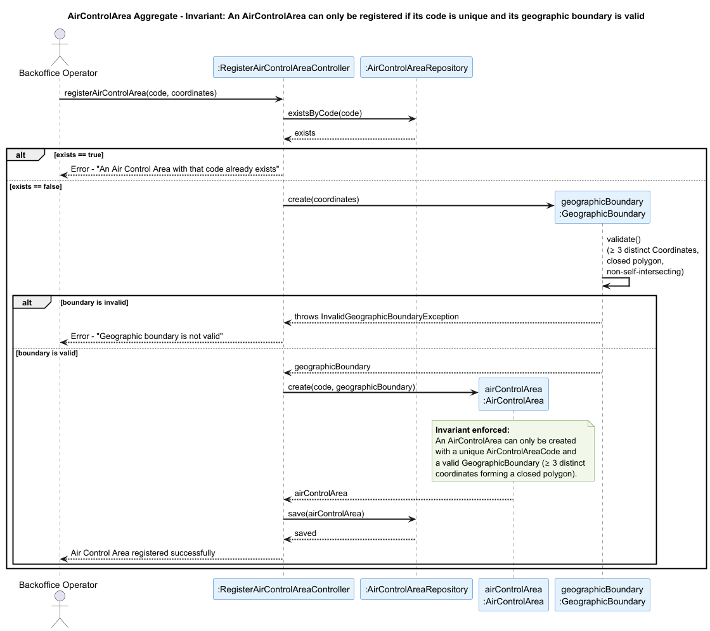

## Airport

### Aggregate Root: `Airport`

### Scenario: Registering an Airport with a Duplicate Code or Invalid Air Control Area

A Backoffice Operator attempts to register a new Airport in the system (US052). The operation must be rejected if the IATA or ICAO code already exists in the system, or if the provided Air Control Area does not exist.

### Invariant Enforced

> **An `Airport` may only be created with a unique `IataCode` and `IcaoCode` worldwide, and must be associated with exactly one existing `AirControlArea`.**

The `Airport` aggregate root is the sole entry point for the creation of an airport. It is therefore the only object capable of consistently enforcing both the uniqueness of the codes and the validity of the associated Air Control Area before any state is persisted. Allowing the registration of an airport with duplicate codes or an invalid area would corrupt the spatial structure of the system, since downstream aggregates such as `FlightRoute` and `WeatherData` depend on `IataCode` and `IcaoCode` to correctly associate themselves with airports.

### Sequence Diagram

