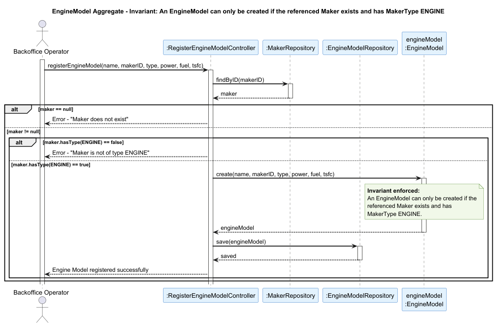

## EngineModel Aggregate

### Aggregate Root: `EngineModel`

### Scenario: Registering an Engine Model for a Maker That Does Not Exist or Is Not of Type ENGINE

A Backoffice Operator attempts to register a new engine model (US056). The operation must be rejected if the referenced maker does not exist or is not of type `ENGINE`.

### Invariant Enforced

> **An `EngineModel` may only be created if the associated `Maker` exists and has `MakerType.ENGINE`.**

The `EngineModel` aggregate root is the sole entry point for the creation of an engine model. It is therefore the only object capable of consistently enforcing that an engine model can only be associated with a manufacturer that is actually qualified to produce engines. Registering an engine model against an invalid or incompatible maker would compromise the integrity of the system, since `EngineModel` instances are later referenced by `AircraftModel` as certified engines.

### Sequence Diagram

