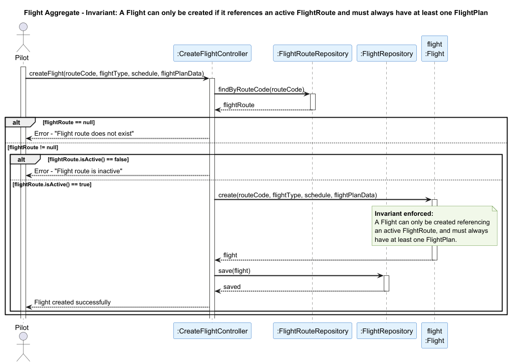

## Flight Aggregate

### Aggregate Root: `Flight`

### Scenario: Creating a Flight for an Inactive Route

A Pilot attempts to register a flight plan for a route (US080). The operation must be rejected if the referenced flight route does not exist or is inactive, or if the flight does not have at least one flight plan associated.

### Invariant Enforced

> **A `Flight` may only be created if it references an active `FlightRoute` via `routeCode`, and must always have at least one `FlightPlan`.**

The `Flight` aggregate root is the sole entry point for the creation of a flight and its plans. It is therefore the only object capable of consistently enforcing that a flight can only take place on an active route, and that a flight without a plan is never persisted. Allowing flights to be created on inactive or nonexistent routes would compromise the integrity of the system, since routes may be deactivated precisely to prevent new flights from being scheduled on them (US074).

### Sequence Diagram

