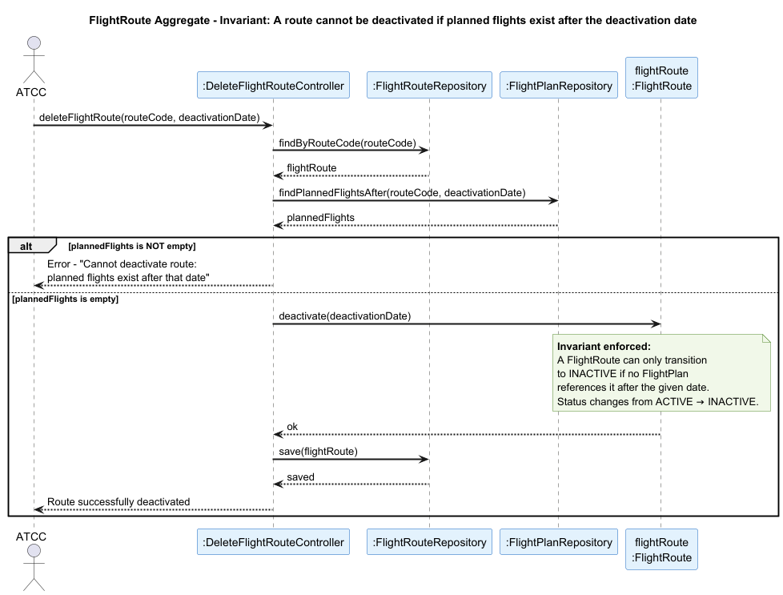

##  FlightRoute Aggregate

### Aggregate Root: `FlightRoute`

### Scenario: Deactivating a Flight Route

An Air Transport Company Collaborator (ATCC) tries to deactivate a flight route from a given date onward (US074). This operation must be rejected if there are any planned flights on that route after the requested deactivation date.

### Invariant Enforced

> **A `FlightRoute` may only transition to `INACTIVE` if no `FlightPlan` references it after the deactivation date.**

This invariant prevents the system from leaving planned flights in an inconsistent state — referencing a route that is no longer active. The `FlightRoute` aggregate root is the sole entry point for changing `RouteStatus`, ensuring the rule is always checked before the state changes.

--- 

### Sequence Diagram

