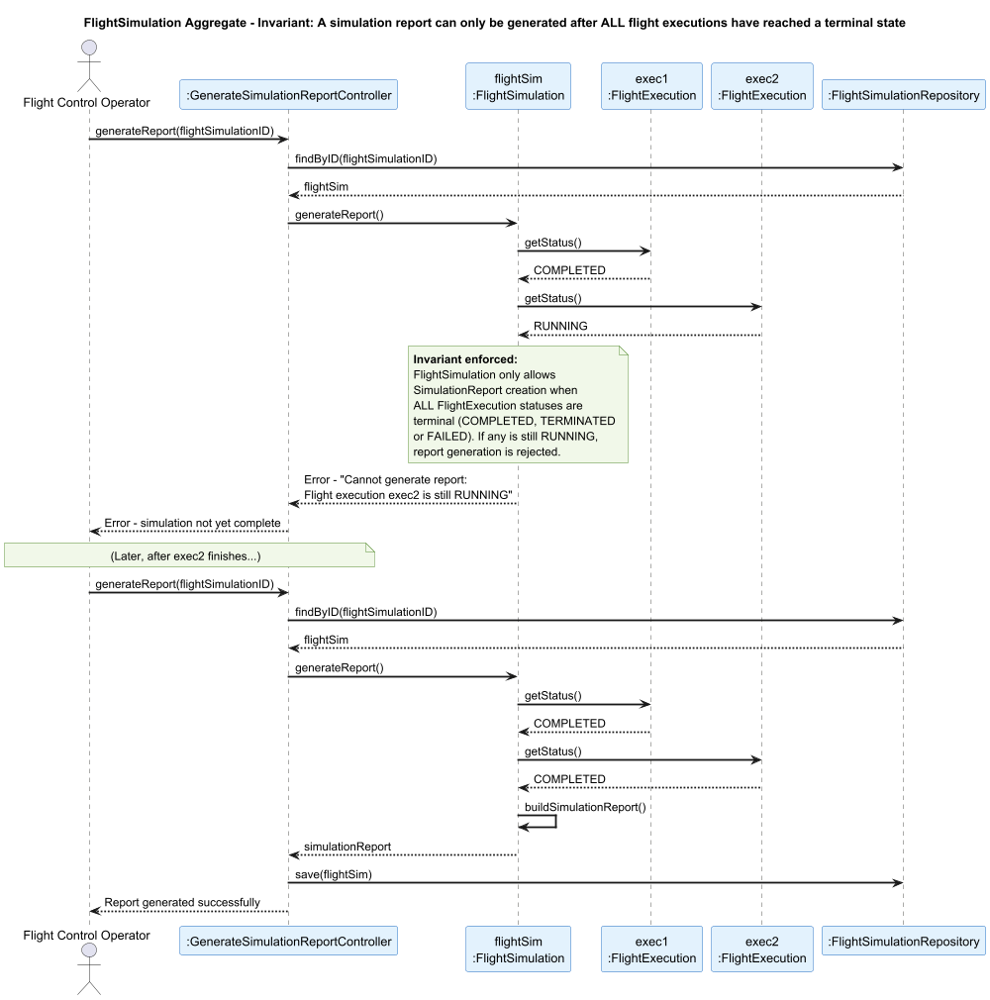

##  FlightSimulation Aggregate

### Aggregate Root: `FlightSimulation`

### Scenario: Generating a Simulation Report

A Flight Control Operator requests the generation of the final simulation report (US109). The report can only be produced once every `FlightExecution` within the simulation has reached a terminal state (`COMPLETED`, `TERMINATED`, or `FAILED`).

### Invariant Enforced

> **A `SimulationReport` may only be created when ALL `FlightExecution` entities within the `FlightSimulation` have a terminal status.**

The `FlightSimulation` aggregate root owns and controls all `FlightExecution` entities. It is therefore the only object capable of consistently checking the collective state of all executions before allowing report generation. Attempting to generate a report while any execution is still `RUNNING` would produce an inaccurate, incomplete report.

---

### Sequence Diagram

