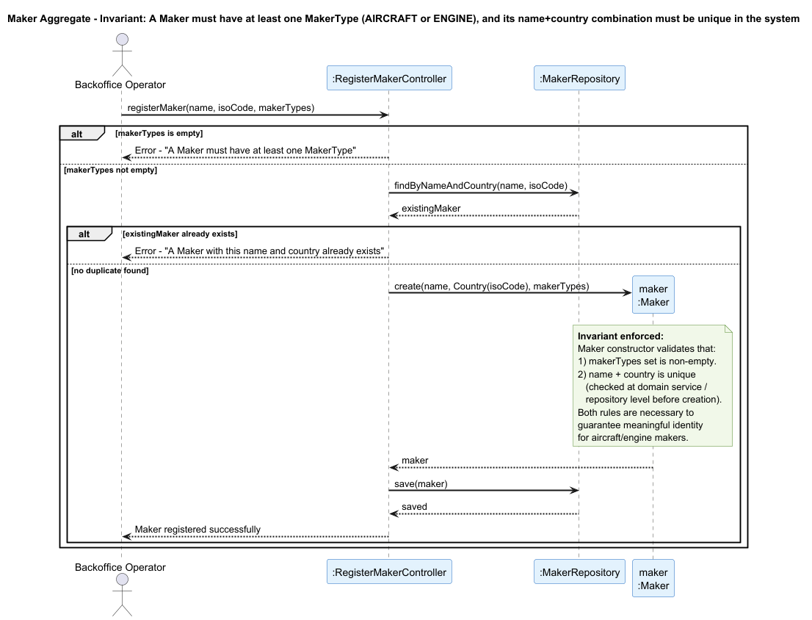

##  Maker Aggregate

### Aggregate Root: `Maker`

### Scenario: Registering a new Maker

A Backoffice Operator wants to register a new aircraft or engine manufacturer (related to US055/US056). The system must ensure no two makers share the same name and country, and that every maker is registered with at least one `MakerType` (`AIRCRAFT` or `ENGINE`).

### Invariant Enforced

> **A `Maker` must have at least one `MakerType` assigned, and the combination of `name + country` must be unique in the system.**

The `Maker` aggregate root encapsulates both rules. The `makerTypes` set being non-empty is an internal structural invariant enforced in the constructor/factory. The uniqueness of `name + country` is enforced before creation via a repository check coordinated by the controller, reflecting a cross-aggregate uniqueness rule. Together, these guarantee that every `Maker` in the system represents a real, unambiguous manufacturer.

---

### Sequence Diagram

