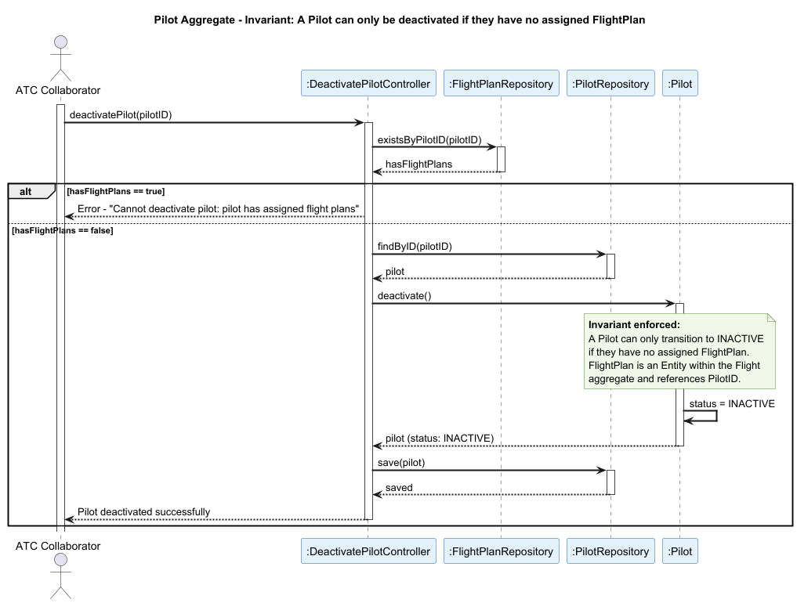

## Pilot

### Aggregate Root: `Pilot`

### Scenario: Deactivating a Pilot Who Still Has Assigned Flight Plans

An Air Transport Company Collaborator attempts to remove a pilot from the company roster (US077). The operation must be rejected if the pilot has one or more `FlightPlan` entities currently assigned to them, as those flight plans would be left without a valid pilot.

### Invariant Enforced

> **A `Pilot` may only transition to `INACTIVE` if they have no assigned `FlightPlan`.**

The `Pilot` aggregate root is the sole entry point for managing a pilot's status within the system. It is therefore the only object capable of consistently enforcing the constraint that no active flight plan is left pilotless. `FlightPlan` is an entity within the `Flight` aggregate and references a `PilotID`; allowing a pilot to be deactivated while flight plans still point to their `PilotID` would result in orphaned plans and break the operational integrity of scheduled flights, since the `FlightSimulation` aggregate depends on resolved flight plans to execute correctly.

### Sequence Diagram

