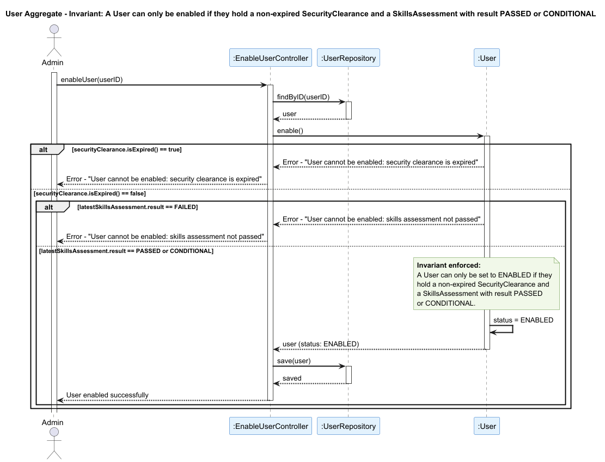

## User

### Aggregate Root: `User`

### Scenario: Enabling a User Without a Valid Security Clearance or Skills Assessment

An Administrator attempts to enable a system user (US032). The operation must be rejected if the user's `SecurityClearance` has already expired, or if their most recent `SkillsAssessment` did not result in `PASSED` or `CONDITIONAL`.

### Invariant Enforced

> **A `User` may only be set to `ENABLED` if they hold a non-expired `SecurityClearance` and a `SkillsAssessment` with a result of `PASSED` or `CONDITIONAL`.**

The `User` aggregate root is the sole entry point for managing a user's lifecycle and status. It is therefore the only object capable of consistently enforcing both security preconditions before any state change is persisted. Allowing a user to be enabled without a valid clearance or a passed assessment would breach the access control model of AISafe, since all system actors — including `Pilot`, `ATCC`, and `Backoffice Operator` roles — are backed by a `User` and must meet these requirements to operate within the system.

### Sequence Diagram

