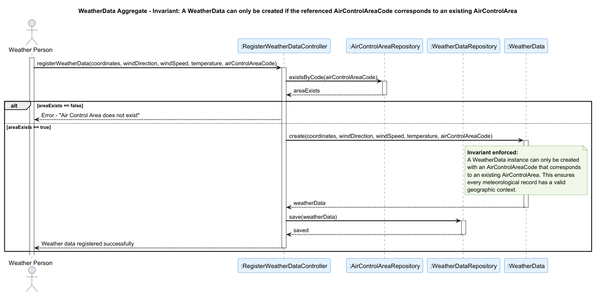

## WeatherData

### Aggregate Root: `WeatherData`

### Scenario: Registering Weather Data for a Non-Existent Air Control Area

A Weather Person attempts to register a meteorological reading in the system (US041). The operation must be rejected if the provided `AirControlAreaCode` does not correspond to any existing `AirControlArea` in the system.

### Invariant Enforced

> **A `WeatherData` instance may only be created if the referenced `AirControlAreaCode` corresponds to an existing `AirControlArea`.**

The `WeatherData` aggregate root is the sole entry point for persisting meteorological readings in the system. It is therefore the only object capable of consistently enforcing that every weather record is bound to a valid geographic context before it is persisted. Allowing weather data to be registered against a non-existent area would make it impossible to retrieve it by area, breaking the consultation flow used by `Pilot` and `FlightControlOperator` actors (US043), and invalidating the environmental inputs consumed by the `FlightSimulation` aggregate when evaluating realistic flight conditions.

### Sequence Diagram

