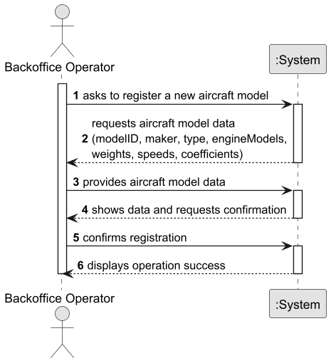

# US055 — Create an Aircraft Model

## 1. Context

The goal is to allow a Backoffice Operator to register a new aircraft model in the system.

---

## 2. Requirements

**US055** As a Backoffice Operator, I want to register a new aircraft model. Any model must have at least one engine model (all engines are of the same type). Aircraft has a model name and manufacturer, and their combination must be unique. At least one certified engine model must be associated. An aircraft model will have a type, maximum range and other flight characteristics. This must also be achieved by a bootstrap process.

**Acceptance Criteria:**

- US055.1 The aircraft model must have a model ID, maker, type, at least one certified engine model, empty weight, MTOW, MZFW, maximum fuel capacity, service ceiling, cruise speed, wing area, drag coefficient (Cd), lift coefficient (Cl), maximum range, maximum passenger capacity, and engine number.
- US055.2 The combination of model ID and manufacturer must be unique in the system.
- US055.3 At least one certified engine model must be associated upon creation.
- US055.4 The associated maker must exist in the system.
- US055.5 All certified engine model IDs must exist in the system.
- US055.6 MTOW must be strictly greater than empty weight.
- US055.7 All numeric values must be strictly positive.
- US055.8 The type must be one of the accepted values: `PASSENGER`, `CARGO`, or `MIXED`.
- US055.9 This must also be achievable by a bootstrap process.
- US055.10 A success message must be shown upon successful registration.
- US055.11 Invalid or incomplete input must produce clear and informative error messages.

**Dependencies/References:**

- Depends on the existence of at least one `Maker` registered in the system.
- Depends on the existence of at least one `EngineModel` registered in the system (US056).
- Is a prerequisite for US057 (Add an Engine Model to an Aircraft Model).
- Is a prerequisite for US058 (Remove an Engine Model from an Aircraft Model).
- Is a prerequisite for US070 (Add an Aircraft to an Air Transport Company).

---

## 3. Analysis

The domain model defines `AircraftModel` as an Aggregate Root identified by `AircraftModelID`. It references a `Maker` aggregate via `MakerID` and multiple `EngineModel` aggregates via a `Set<EngineModelID>` (cross-aggregate references by ID, following DDD principles).

Key business rules identified:
- An `AircraftModel` can only be created if the referenced `Maker` exists in the system.
- All `EngineModelID` values in `certifiedEngineModelIDs` must reference existing engine models.
- The set `certifiedEngineModelIDs` must contain at least one element — this is the core invariant of this aggregate, as documented in `AircraftModel.md` (US011).
- `mtow` must be strictly greater than `emptyWeight`.
- The pair (`AircraftModelID`, `MakerID`) must be unique across all aircraft models.
- All numeric values must be strictly positive.
- The `AircraftType` must be one of: `PASSENGER`, `CARGO`, `MIXED`.

### System Sequence Diagram (SSD)



---

## 4. Design

### 4.1. Realization

**Sequence Diagram (SD):**


**Class Diagram (CD):**


### 4.2. Acceptance Tests

**Test 1:** Verifies that it is not possible to create an aircraft model with a maker that does not exist.

**Refers to Acceptance Criteria:** US055.4

```java
@Test
void ensureAircraftModelCannotBeRegisteredWithNonExistentMaker() {
    assertThrows(IllegalArgumentException.class, () ->
            service.registerAircraftModel(..., MakerID.of("DOES_NOT_EXIST"), ...));
}
```

**Test 2:** Verifies that it is not possible to create an aircraft model with no certified engine models.

**Refers to Acceptance Criteria:** US055.3

```java
@Test
void ensureAircraftModelCannotBeRegisteredWithNoEngineModels() {
    assertThrows(IllegalArgumentException.class, () ->
            service.registerAircraftModel(..., Set.of(), ...));
}
```

**Test 3:** Verifies that it is not possible to create an aircraft model with a non-existent engine model.

**Refers to Acceptance Criteria:** US055.5

```java
@Test
void ensureAircraftModelCannotBeRegisteredWithNonExistentEngineModel() {
    assertThrows(IllegalArgumentException.class, () ->
            service.registerAircraftModel(...,
                    Set.of(EngineModelID.of("DOES_NOT_EXIST")), ...));
}
```

**Test 4:** Verifies that MTOW must be greater than empty weight.

**Refers to Acceptance Criteria:** US055.6

```java
@Test
void ensureAircraftModelCannotHaveMtowLessThanEmptyWeight() {
    assertThrows(IllegalArgumentException.class, () ->
            new AircraftModel(..., emptyWeight: 100.0, mtow: 50.0, ...));
}
```

**Test 5:** Verifies that it is not possible to register two aircraft models with the same model ID and maker.

**Refers to Acceptance Criteria:** US055.2

```java
@Test
void ensureAircraftModelCannotBeRegisteredWithDuplicateModelIDAndMaker() {
    service.registerAircraftModel(AircraftModelID.of("A320"), makerID, ...);
    assertThrows(IllegalStateException.class, () ->
            service.registerAircraftModel(AircraftModelID.of("A320"), makerID, ...));
}
```

---

## 5. Implementation

The implementation follows the layered architecture promoted by the EAPLI Framework:

- **Domain:** `AircraftModel` (Aggregate Root), `AircraftModelID`, `AircraftType` — enforce all business invariants via `Preconditions`. Key invariants: `mtow > emptyWeight`, `certifiedEngineModelIDs` not empty, all numeric values positive.
- **Domain Service:** `AircraftModelService` coordinates cross-aggregate validation (maker existence, engine model existence, uniqueness) before creating the aircraft model. This logic cannot live inside `AircraftModel` itself as aggregates must remain persistence-ignorant.
- **Repository:** `AircraftModelRepository` interface in the domain; `InMemoryAircraftModelRepository` in the infrastructure layer.
- **Application:** `RegisterAircraftModelController` orchestrates authorization and delegates to the domain service.
- **Presentation:** `RegisterAircraftModelUI` handles user interaction via console, with input validation loops for all numeric and selection fields. Allows selection of multiple certified engine models.
- **Bootstrap:** `AircraftModelBootstrapper` creates initial aircraft models on system startup using the domain service directly (bypassing authorization), satisfying US055.9. Depends on `MakerBootstrapper` and `EngineModelBootstrapper` running first. Initial data based on the aircraft XML provided by the Product Owner (Boeing 777-200ER and Airbus A380).

The `PersistenceContext` provides access to all repositories, enabling the service to remain decoupled from persistence details (NFR08 — database by configuration).

---

## 6. Integration/Demonstration

This US integrates with:
- **Maker aggregate** — the `AircraftModelService` validates the maker's existence before creating the aircraft model.
- **EngineModel aggregate** — the `AircraftModelService` validates that all `certifiedEngineModelIDs` reference existing engine models. US056 must be completed before this US.
- **Backoffice Menu** — `RegisterAircraftModelUI` is accessible via `Backoffice Config > Register Aircraft Model` in the backoffice console application.
- **Bootstrap process** — `MakerBootstrapper`, `EngineModelBootstrapper` and `AircraftModelBootstrapper` are called from `MasterUsersBootstrapper` on system startup in this order.
---

## 7. Observations

- All engines on a given aircraft are of the same model, as clarified by the Product Owner in US055. This is captured by `engineNumber` (how many engines) and `certifiedEngineModelIDs` (which models are allowed).
- The `AircraftModelID` serves as both the unique identifier and the model name (e.g. "A320", "B737-Max-8"), as confirmed by the Product Owner.
- A Domain Service (`AircraftModelService`) was introduced to handle cross-aggregate invariant enforcement — validating maker and engine model existence — following the DDD principle that aggregates must remain persistence-ignorant.
- The `maximumRange` field represents the manufacturer-specified maximum range and is provided by the Backoffice Operator at registration time. Actual range calculation during simulation is handled by the SCOMP component.
- The bootstrappers use the domain service directly instead of the controller to avoid authorization checks that require an authenticated user session.