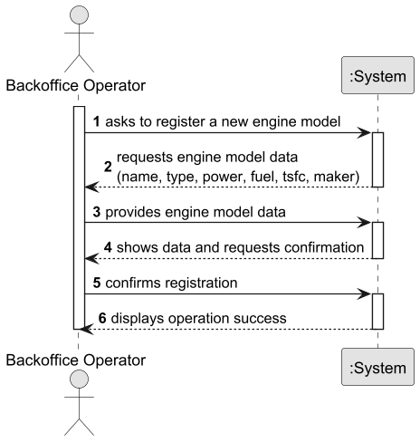
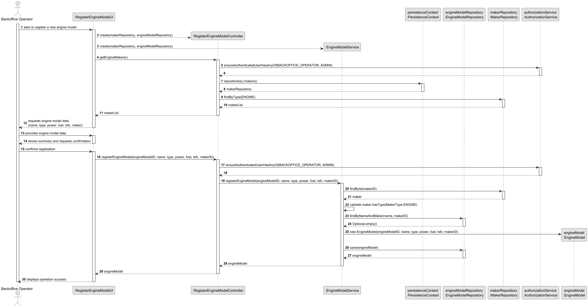
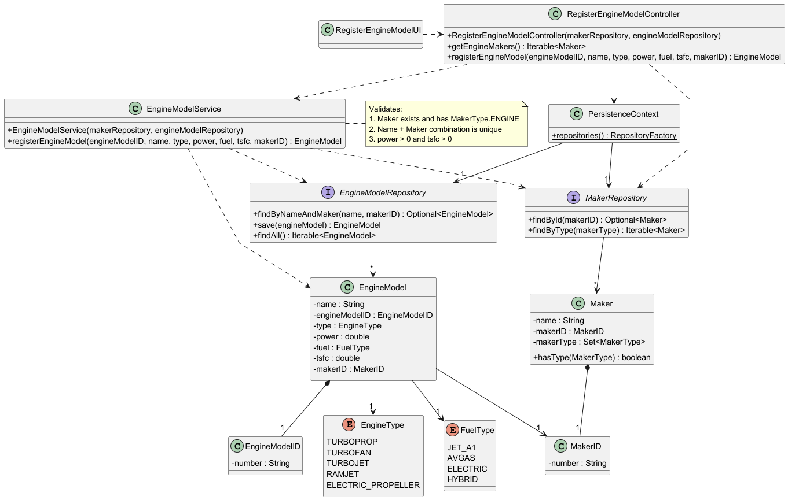

# US056 — Create an Aircraft Engine Model

## 1. Context

The goal is to allow a Backoffice Operator to register a new aircraft engine model in the system.

---

## 2. Requirements

**US056** As a Backoffice Operator, I want to register a new engine model to be used by aircraft. The model's name and manufacturer combination must be unique. Other important information regarding the type (turboprop, turbofan, turbojet, ramjet, electric propeller), power, fuel, and efficiency (TSFC) should be included.

**Acceptance Criteria:**

- US056.1 The engine model must have a name, type, power, fuel type, and TSFC value.
- US056.2 The combination of name and manufacturer must be unique in the system.
- US056.3 The associated maker must exist in the system and must be of type `ENGINE`.
- US056.4 Power and TSFC values must be strictly positive.
- US056.5 This must also be achievable by a bootstrap process.
- US056.6 A success message must be shown upon successful registration.
- US056.7 Invalid or incomplete input must produce clear and informative error messages.

**Dependencies/References:**

- Depends on the existence of at least one `Maker` of type `ENGINE` registered in the system.
- Is a prerequisite for US055 (Create an Aircraft Model), which requires at least one certified engine model.
- Is a prerequisite for US057 (Add an Engine Model to an Aircraft Model).

---

## 3. Analysis

The domain model defines `EngineModel` as an Aggregate Root identified by `EngineModelID`. It references a `Maker` aggregate via `MakerID` (cross-aggregate reference by ID, following DDD principles).

Key business rules identified:
- An `EngineModel` can only be created if the referenced `Maker` exists and has `MakerType.ENGINE`. This is the core invariant of this aggregate, as documented in `EngineModel.md` (US011).
- The pair (name, makerID) must be unique across all engine models.
- `power` and `tsfc` must be positive doubles.
- Fuel type is pre-loaded as an enum (`JET_A1`, `AVGAS`, `ELECTRIC`, `HYBRID`) following the Product Owner's guidance to use a bootstrapped list for the MVP.

### System Sequence Diagram (SSD)



---

## 4. Design

### 4.1. Realization

**Sequence Diagram (SD):**



**Class Diagram (CD):**



### 4.2. Acceptance Tests

**Test 1:** Verifies that it is not possible to create an engine model with a maker that does not exist.

**Refers to Acceptance Criteria:** US056.3

```java
@Test
void ensureEngineModelCannotBeRegisteredWithNonExistentMaker() {
    assertThrows(IllegalArgumentException.class, () ->
            service.registerEngineModel(..., MakerID.of("DOES_NOT_EXIST")));
}
```

**Test 2:** Verifies that it is not possible to create an engine model with a maker that is not of type ENGINE.

**Refers to Acceptance Criteria:** US056.3

```java
@Test
void ensureEngineModelCannotBeRegisteredWithMakerThatIsNotEngine() {
    assertThrows(IllegalStateException.class, () ->
            service.registerEngineModel(..., AIRCRAFT_MAKER_ID));
}
```

**Test 3:** Verifies that it is not possible to register two engine models with the same name and maker.

**Refers to Acceptance Criteria:** US056.2

```java
@Test
void ensureEngineModelCannotBeRegisteredWithDuplicateNameAndMaker() {
    service.registerEngineModel(EngineModelID.of("EM001"), "CFM56-7B", ...);
    assertThrows(IllegalStateException.class, () ->
            service.registerEngineModel(EngineModelID.of("EM002"), "CFM56-7B", ...));
}
```

**Test 4:** Verifies that it is not possible to create an engine model with non-positive power.

**Refers to Acceptance Criteria:** US056.4

```java
@Test
void ensureEngineModelCannotHaveZeroPower() {
    assertThrows(IllegalArgumentException.class, () ->
            new EngineModel(EngineModelID.of("EM001"), "CFM56-7B",
                    EngineType.TURBOFAN, 0.0, FuelType.JET_A1, 0.37, MakerID.of("CFM")));
}
```

---

## 5. Implementation

The implementation follows the layered architecture promoted by the EAPLI Framework:

- **Domain:** `EngineModel` (Aggregate Root), `EngineModelID`, `EngineType`, `FuelType` — enforce all business invariants via `Preconditions` and `Invariants`.
- **Domain Service:** `EngineModelService` coordinates cross-aggregate validation (maker existence and type) before creating the engine model. This logic cannot live inside `EngineModel` itself as aggregates must remain persistence-ignorant.
- **Repository:** `EngineModelRepository` interface in the domain; `InMemoryEngineModelRepository` in the infrastructure layer.
- **Application:** `RegisterEngineModelController` orchestrates authorization and delegates to the domain service.
- **Presentation:** `RegisterEngineModelUI` handles user interaction via console, with input validation loops for all numeric and selection fields.
- **Bootstrap:** `EngineModelBootstrapper` creates initial engine models on system startup using the same controller, satisfying US056.5. Depends on `MakerBootstrapper` running first.

The `PersistenceContext` provides access to all repositories, enabling the controller to remain decoupled from persistence details (NFR08 — database by configuration).

---

## 6. Integration/Demonstration

This US integrates with:
- **Maker aggregate** — the `EngineModelService` validates the maker's existence and type before creating the engine model.
- **US055** — aircraft models reference engine models via `certifiedEngineModelIDs`; this US must be completed first.
- **Backoffice Menu** — `RegisterEngineModelUI` is accessible via `Backoffice Config > Register Engine Model` in the backoffice console application.
- **Bootstrap process** — `MakerBootstrapper` and `EngineModelBootstrapper` are called from `MasterUsersBootstrapper` on system startup.

(...)


---

## 7. Observations

- The `tsfc` field stores fuel consumption per unit of thrust (N/N/s), as specified in section 3.3 of the requirements document. Unit consistency is enforced at the UI level.
- No direct relationship to `Aircraft` exists at this level — that coupling is managed via `AircraftModel.certifiedEngineModelIDs`.
- Fuel type is implemented as a pre-loaded enum following the Product Owner's guidance: *"Pre-loading the available types of fuel looks like a good solution when developing a MVP."*
- A Domain Service (`EngineModelService`) was introduced to handle cross-aggregate invariant enforcement, following the DDD principle that aggregates must remain persistence-ignorant.