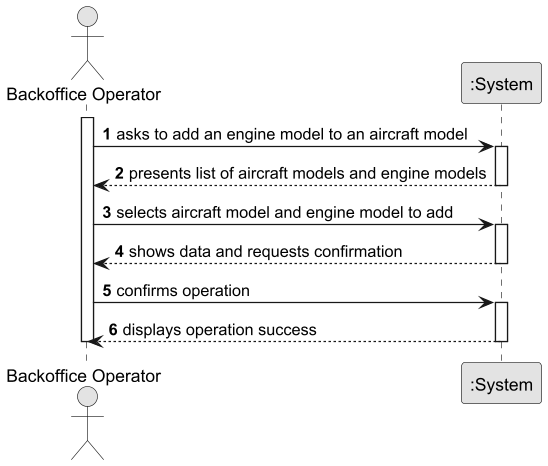

# US057 — Add an Engine Model to an Aircraft Model

## 1. Context

The goal is to allow a Backoffice Operator to add a new certified engine model to an existing aircraft model's list of certified engines.

---

## 2. Requirements

**US057** As a Backoffice Operator, I want to add an engine model to an aircraft model's list of certified engines. Engine type must be compatible. The same engine model cannot be added twice to the same aircraft. An aircraft model might have several aircraft variants (combinations of model and engine configuration).

**Acceptance Criteria:**

- US057.1 The aircraft model must exist in the system.
- US057.2 The engine model must exist in the system.
- US057.3 The engine model must not already be certified for the selected aircraft model.
- US057.4 The engine type must be compatible with the existing certified engines — all certified engines of an aircraft model must be of the same `EngineType`.
- US057.5 A success message must be shown upon successful operation.
- US057.6 Invalid or incomplete input must produce clear and informative error messages.

**Dependencies/References:**

- Depends on US055 (Create an Aircraft Model) — at least one aircraft model must exist.
- Depends on US056 (Create an Engine Model) — at least one engine model must exist.
- Is related to US058 (Remove an Engine Model from an Aircraft Model).

---

## 3. Analysis

The `AircraftModel` aggregate already holds a `Set<EngineModelID>` for certified engines. This US adds a new `EngineModelID` to that set, subject to validation.

Key business rules identified:
- The `AircraftModel` must exist in the system.
- The `EngineModel` must exist in the system.
- The `EngineModel` must not already be in `certifiedEngineModelIDs` — no duplicates.
- The `EngineType` of the new engine model must match the `EngineType` of the existing certified engines — all certified engines of an aircraft model must be of the same type. This is enforced by the `AircraftModelService`.
- The modification is made to the existing `AircraftModel` aggregate via `addCertifiedEngine()` — the aggregate root controls this change.

### System Sequence Diagram (SSD)



---

## 4. Design

### 4.1. Realization

**Sequence Diagram (SD):**


**Class Diagram (CD):**


### 4.2. Acceptance Tests

**Test 1:** Verifies that it is not possible to add an engine model to a non-existent aircraft model.

**Refers to Acceptance Criteria:** US057.1

```java
@Test
void ensureCannotAddEngineModelToNonExistentAircraftModel() {
    assertThrows(IllegalArgumentException.class, () ->
            service.addEngineModel(AircraftModelID.of("DOES_NOT_EXIST"), ENGINE_MODEL_ID));
}
```

**Test 2:** Verifies that it is not possible to add a non-existent engine model.

**Refers to Acceptance Criteria:** US057.2

```java
@Test
void ensureCannotAddNonExistentEngineModel() {
    assertThrows(IllegalArgumentException.class, () ->
            service.addEngineModel(AIRCRAFT_MODEL_ID, EngineModelID.of("DOES_NOT_EXIST")));
}
```

**Test 3:** Verifies that the same engine model cannot be added twice.

**Refers to Acceptance Criteria:** US057.3

```java
@Test
void ensureCannotAddAlreadyCertifiedEngineModel() {
    assertThrows(IllegalStateException.class, () ->
            service.addEngineModel(AIRCRAFT_MODEL_ID, ENGINE_MODEL_ID));
}
```

**Test 4:** Verifies that an engine model with an incompatible type cannot be added.

**Refers to Acceptance Criteria:** US057.4

```java
@Test
void ensureCannotAddEngineModelWithIncompatibleType() {
    assertThrows(IllegalStateException.class, () ->
            service.addEngineModel(AIRCRAFT_MODEL_ID, TURBOPROP_ENGINE_ID));
}
```

---

## 5. Implementation

The implementation follows the layered architecture promoted by the EAPLI Framework:

- **Domain:** `AircraftModel` — updated with `addCertifiedEngine(EngineModelID)` method. The aggregate root is the sole entry point for modifying the `certifiedEngineModelIDs` set, following DDD principles.
- **Domain Service:** `AircraftModelService` — updated with `addEngineModel(aircraftModelID, engineModelID)` method. Validates maker existence, engine model existence, no duplicates, and engine type compatibility. This cross-aggregate validation cannot live inside the `AircraftModel` aggregate itself as it requires repository access.
- **Application:** `AddEngineModelToAircraftModelController` — new controller that orchestrates authorization and delegates to the domain service.
- **Presentation:** `AddEngineModelToAircraftModelUI` — new UI that presents aircraft models (with their certified engines) and engine models, and collects the operator's selection.

No new repositories were needed — this US reuses `AircraftModelRepository` and `EngineModelRepository`.

---

## 6. Integration/Demonstration

This US integrates with:
- **AircraftModel aggregate** — adds a new `EngineModelID` to the `certifiedEngineModelIDs` set via `addCertifiedEngine()`.
- **EngineModel aggregate** — validates that the engine model exists and checks its `EngineType` for compatibility.

---

## 7. Observations

- The `addCertifiedEngine()` method is added to the `AircraftModel` aggregate root — the aggregate is the sole entry point for modifying its `certifiedEngineModelIDs` set, following DDD principles.
- The compatibility check (same `EngineType`) is enforced by the `AircraftModelService`, not the `AircraftModel` itself, because it requires looking up the `EngineModel` aggregate to obtain its type — a cross-aggregate operation that requires repository access.
- No new repositories are needed for this US — it reuses `AircraftModelRepository` and `EngineModelRepository`.
